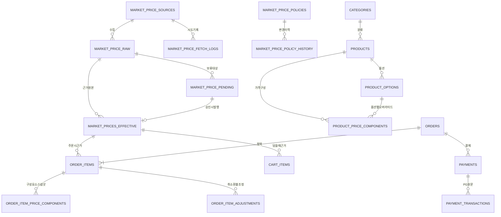

# 한성금거래소 쇼핑몰 — 전체 개발 계획서

- 문서 버전: **v1.0**
- 작성일: 2026-08-20
- 도메인: https://hanseongge.com
- 참고 사이트: https://www.kaggold.com/
- 선행 문서: `STEP1_한성금거래소_쇼핑몰_설계서.md` (v0.2 확정), `TODO_보류항목.md`
- 현재 위치: **STEP 2 완료 (Flyway V1~V5, 32테이블) → STEP 3 착수 직전**
- 목표 오픈: 2026-10 중순 (**D-8주**)

---

## 0. 현행 분석

### 0.1 자산 현황

| 구분 | 경로 | 상태 | 판정 |
|---|---|---|---|
| 설계서 v0.2 | `files/STEP1_...설계서.md` | 확정 | **계승** |
| 보류항목 관리 | `files/TODO_보류항목.md` | 운영 중 | **계승** |
| DB 스키마 | `files/V1~V5__*.sql` | PostgreSQL 16 실행 검증 완료 | **보강 필요 (V6)** |
| 레거시 프로토타입 | `hansung-gold_OLD/` | Maven + Thymeleaf + H2 + 네이버 크롤링 | **폐기 / 자산만 회수** |

레거시(`hansung-gold_OLD`)는 Maven·Thymeleaf 모놀리식·H2·MySQL 전제·`ddl-auto: update`로, 확정 아키텍처(Gradle·FE/BE 분리·PostgreSQL·Flyway)와 전면 불일치합니다. 코드는 이관하지 않고 아래 3가지만 회수합니다.

1. `static/images/logo.png` — 브랜드 로고
2. `templates/index.html` (148KB) — 메인 화면 마크업/디자인 토큰 (Next.js 컴포넌트로 재작성)
3. `GoldPriceCrawler.java` — 18K/14K 환산 계수, 매입/판매 마진율(+5%/-7%)의 **영업 정책 참고값**

> 레거시 크롤러의 "마진율을 코드 상수로 박아둔 방식"은 이번 요구사항(원본/보정 분리)에 정면으로 위배됩니다. 해당 상수들은 코드가 아니라 `market_price_policies` 행으로 이관됩니다.

### 0.2 요구사항 대비 적합성 진단 — **결함 12건**

기존 스키마를 이번 요구사항 기준으로 전수 검증한 결과입니다. `치명`은 요구사항을 구조적으로 충족하지 못하는 항목입니다.

| # | 등급 | 위치 | 문제 | 해결 |
|---|---|---|---|---|
| D-1 | **치명** | `products` | 주얼리 확장 요구("금시세×중량+공임+**부자재**+…") 불가. 가격 항목이 `labor_cost` 단일 컬럼으로 고정 | `product_price_components` 신설 (§13) |
| D-2 | **치명** | `order_items` | 구성요소별 금액 Snapshot 불가. 부자재·스톤·마진 내역이 주문에 남지 않음 | `order_item_price_components` 신설 (§10) |
| D-3 | **치명** | `market_price_raw` | `price_per_gram NOT NULL CHECK(>0)` 인데 `status='FAILED'` 값이 존재 → **수집 실패를 기록할 수 없음**. "API 오류/timeout" 요구사항 미충족 | `market_price_fetch_logs` 신설 + `FAILED` 제거 (§12) |
| D-4 | **치명** | `market_price_policies` | 관리자 보정 정책의 **변경 이력이 없음**(현재값 1행 UPDATE). "관리자 수동 변경" 추적 요구 미충족 | `market_price_policy_history` 신설 (§12) |
| D-5 | **높음** | `market_price_policies` | MANUAL 모드에서 관리자 최종가가 `manual_price`에 저장되어 **원본 레이어를 건너뜀**. "원본과 보정을 분리" 원칙이 주력 입력 경로에서 깨짐 | MANUAL 고시도 `raw`에 INSERT (§12.3) |
| D-6 | **높음** | `payments` / `payment_transactions` | **멱등성 키 없음**. PG 콜백 중복 수신 시 이중 승인 가능 | `idempotency_key UNIQUE` (§11) |
| D-7 | **높음** | `products` | 옵션 없는 상품의 **재고 필드가 없음**(재고는 `product_options.stock`뿐) | 기본 옵션 자동 생성 강제 (§9) |
| D-8 | **높음** | `order_items` | `option_id` 미보관(`option_name` 문자열만) → 반품·재구매·통계에서 옵션 역추적 불가 | 컬럼 추가 (§10) |
| D-9 | **높음** | (없음) | **약관 동의 이력 테이블 부재**. 전자상거래법·개인정보보호법상 필수 | `user_agreements` 신설 (§7) |
| D-10 | 중간 | 설계서 §3.1 ↔ V2 | 설계서에 있는 `max_change_percent` 컬럼이 실제 DDL에 **누락**(전역 설정값만 존재) | 금속별 임계값 컬럼 추가 (§12) |
| D-11 | 중간 | `market_prices_effective` | 원본가·보정액이 컬럼에 없어 "원본 200,000 / 보정 +10,000 / 최종 210,000" 3값을 한 행에서 못 읽음 (조인 필요, MANUAL은 조인 대상도 없음) | 스냅샷 컬럼 3개 추가 (§12) |
| D-12 | 중간 | `market_price_raw` | **중복 데이터 방지 제약 없음**. 동일 시세 반복 수집이 무한 적재 | `(source_id, metal_type, quote_at)` UNIQUE (§12) |

추가 개선 권고(비차단): `refresh_tokens` 회전·재사용 감지 컬럼, `order_status_histories`, `price_calculation_logs`(설계서에 명시됐으나 DDL 누락), `cart_items.effective_price_id_at_add`, `market_price_pending`의 정책 스냅샷·중복 방지.

### 0.3 요청 기술 스택 vs 확정 사항 — **차이 3건 (사용자 확인 필요)**

| 항목 | 이번 요청 | v0.2 확정 | 본 문서 권고 |
|---|---|---|---|
| **Docker** | 사용 | **미사용 확정** (systemd) | **절충: 개발/CI는 Docker(PostgreSQL 컨테이너), 운영 배포는 systemd 유지.** Dockerfile은 미리 작성해 Phase 2 전환만 대비. 근거: 단일 인스턴스·운영 인력 1인·D-8주. 오케스트레이션 도입은 오픈 후 |
| **React or Vue** | 택일 | Next.js(React) | **Next.js 유지.** 네이버 SEO를 위해 SSR이 필수이고, 쇼핑몰+`/admin`을 한 프로젝트로 운영 가능 |
| **QueryDSL or MyBatis** | 택일 | QueryDSL 언급 | **QueryDSL 단독 채택.** 상품 검색·시세 이력의 동적 조건에 타입 안전. MyBatis 병행은 이중 학습·이중 매핑 비용만 발생. 통계성 복합 쿼리는 네이티브 쿼리로 충분 |
| **ERP 연계** | "향후 연계 가능하도록 API 중심 설계" | "ERP 연동 전면 제외" | **모순 아님.** 연동 *개발*은 제외, 연계 *가능성*은 설계로 확보 → §1.3에 구체안 |

---

## 1. 전체 시스템 아키텍처

### 1.1 구성도

```
        [사용자 브라우저]                      [관리자 브라우저]
              │ HTTPS(443)                          │ HTTPS(443) + IP 제한
              ▼                                     ▼
   ┌───────────────────────────────────────────────────────────┐
   │  Nginx  — TLS 종단 / 정적자산 / 리버스프록시 / Rate Limit    │
   │  hanseongge.com → :3000   |   api.hanseongge.com → :8080   │
   └────────────┬──────────────────────────┬───────────────────┘
                │                          │
     ┌──────────▼──────────┐    ┌──────────▼─────────────────┐
     │ Next.js 15 (SSR)    │    │ Spring Boot 3.3 REST API   │
     │  (shop) + /admin    │───▶│  Java 21 / Gradle          │
     │  systemd: web.svc   │ SSR│  systemd: api.svc          │
     └─────────────────────┘ 호출└──────┬──────────┬──────────┘
                                        │          │
                        ┌───────────────▼──┐  ┌────▼──────────────────┐
                        │ PostgreSQL 16    │  │ 외부 연동              │
                        │ NCP Cloud DB     │  │ · PG (통합 결제창)      │
                        │ Private Subnet   │  │ · OAuth2 (G/N/K)      │
                        └──────────────────┘  │ · KRX 시세 (선택)      │
                                              │ · NCP Object Storage  │
                        [Caffeine 인메모리 캐시] └───────────────────────┘
```

### 1.2 아키텍처 원칙 (위반 시 리뷰 반려)

| # | 원칙 |
|---|---|
| P1 | **가격의 최종 판단은 항상 Backend.** Frontend가 보낸 금액은 어떤 경우에도 신뢰하지 않는다 |
| P2 | **시세·주문가격 테이블은 append-only.** UPDATE로 값을 덮어쓰는 경로를 DB 트리거로 봉쇄한다 |
| P3 | **모든 금액·중량은 `BigDecimal` / `NUMERIC`.** `double`·`float` 사용 금지 (컴파일 리뷰 항목) |
| P4 | Controller → Service → Repository. Entity 직접 반환 금지, 비즈니스 로직은 Service 전용 |
| P5 | 외부 연동(시세·PG·스토리지)은 전부 인터페이스 뒤에 둔다. 구현체 교체가 도메인에 파급되지 않아야 한다 |
| P6 | 외부 시스템 실패가 **가격을 0·NULL로 만드는 경로는 존재하지 않는다.** 실패 = 기존 값 유지 |

### 1.3 ERP 연계 대비 설계 (개발은 Phase 2, 자리만 확보)

ERP 개발은 최소 1년 후이므로 지금 연동을 만들지 않습니다. 대신 나중에 **스키마 변경 없이** 붙일 수 있도록 4가지만 확보합니다.

1. **연계 지점을 3개로 한정** — ① 시세 수신 ② 상품·재고 동기 ③ 주문 전송. 이 3개 외의 결합은 만들지 않는다.
2. **외부키 컬럼 예약** — `products.external_ref`, `orders.external_ref`, `market_price_sources.code='ERP'` 를 지금 넣어둔다 (V6).
3. **시세 소스 레지스트리** — ERP는 `MANUAL`/`KRX`와 동급의 Provider 한 개로 추가되면 끝나도록 이미 설계됨(`market_price_sources`).
4. **REST API 우선** — 관리자 화면조차 자체 API를 소비한다. 화면 전용 로직을 Service에 두지 않으므로 ERP가 같은 API를 호출할 수 있다.

> Outbox 테이블·메시지 큐는 지금 만들지 않습니다. 실사용 없는 인프라는 유지비만 발생합니다.

---

## 2. Frontend / Backend 구조

### 2.1 책임 분리

| 계층 | 담당 | **하지 않는 것** |
|---|---|---|
| Next.js (FE) | 화면, SSR/SEO, 입력 검증(UX용), 서버 계산값 **표시만** | 가격 계산, 권한 판정, 금액 합산 |
| Spring Boot (BE) | 가격 계산, 시세 적용, 인증·인가, 주문·결제 검증, 감사 로그 | 화면 렌더링 |
| PostgreSQL | 무결성 제약, append-only 강제(트리거), 이력 보존 | 비즈니스 계산 (프로시저 사용 안 함) |

### 2.2 Backend 계층

```
Controller  (@RestController)  DTO 입출력, Bean Validation, 권한 어노테이션
    ↓
Service     (@Transactional)   비즈니스 로직 / 가격 계산 / 도메인 이벤트 발행
    ↓
Repository  (JPA + QueryDSL)   영속화, 동적 조회
    ↓
Entity                          도메인 모델 (setter 최소화, 정적 팩토리)
```

**핵심 Service 3종** (이 프로젝트의 심장부, 테스트 커버리지 최우선):

- `MarketPriceService` — 원본 수집 → 검증 → 정책 적용 → effective 발행
- `PriceCalculationService` — 상품 가격 계산 (§13)
- `OrderService` — 서버 재계산 → Snapshot 확정 (§10)

### 2.3 Frontend 구조

- **App Router** 사용. 상품/시세/공지는 SSR 또는 ISR(재검증 짧게), 장바구니·마이페이지는 CSR.
- **가격은 절대 클라이언트에서 계산하지 않는다.** API가 준 `finalUnitPrice`를 포맷팅만 한다.
- 시세 표시는 `GET /api/v1/prices/current` 폴링(30~60초) 또는 SSE. 초기엔 폴링으로 충분.
- 관리자 화면은 동일 프로젝트 `/admin`, `robots: noindex`, 별도 인증 컨텍스트.

---

## 3. 디렉터리 구조

```
hanseongge/
├── backend/
│   ├── build.gradle                     # Gradle (Kotlin DSL 아님, Groovy)
│   └── src/main/java/com/hanseongge/
│       ├── HanseonggeApplication.java
│       ├── global/
│       │   ├── config/       SecurityConfig, AdminSecurityConfig, CorsConfig,
│       │   │                 SwaggerConfig, JpaConfig, QuerydslConfig, CacheConfig
│       │   ├── auth/         JwtProvider, JwtFilter, OAuth2SuccessHandler,
│       │   │                 AdminAuthService, RefreshTokenService
│       │   ├── error/        ErrorCode, BusinessException, GlobalExceptionHandler
│       │   ├── audit/        AuditLogService, @Audited AOP
│       │   ├── money/        ★ Money, Weight, RoundingPolicy, VatPolicy (BigDecimal 전용)
│       │   └── storage/      ObjectStorageClient (NCP)
│       └── domain/
│           ├── user/         User, SocialAccount, UserAgreement
│           ├── admin/        AdminUser, Role
│           ├── marketprice/  ★★ 시세 (§12)
│           │   ├── entity/   MarketPriceRaw, Policy, PolicyHistory,
│           │   │             Effective, Pending, FetchLog, Source
│           │   ├── provider/ MarketPriceProvider, ManualProvider, KrxProvider
│           │   ├── service/  MarketPriceService, PriceValidator, PolicyApplier
│           │   └── scheduler/MarketPriceScheduler
│           ├── pricing/      ★★ PriceCalculationService, ComponentCalculator,
│           │                 PriceResult, PriceQuote (§13)
│           ├── product/      Category, Product, ProductOption,
│           │                 ProductPriceComponent, ProductImage
│           ├── cart/         Cart, CartItem
│           ├── order/        ★★ Order, OrderItem, OrderItemPriceComponent,
│           │                 OrderItemAdjustment, OrderStatusHistory (§10)
│           ├── payment/      PaymentProvider(interface), Payment,
│           │                 PaymentTransaction, providers/ (§11)
│           ├── shipment/     Shipment
│           ├── promotion/    Coupon, CouponIssue, Event
│           ├── board/        Notice, News, Faq, Qna, Store
│           └── setting/      SystemSetting, SettingService
│
├── backend/src/main/resources/db/migration/
│   └── V1__init.sql … V5__content.sql, V6__pricing_and_fixes.sql   ← 신규
│
├── frontend/
│   └── src/
│       ├── app/
│       │   ├── (shop)/       page.tsx, price/, shop/[category]/,
│       │   │                 shop/product/[id]/, cart/, order/, mypage/,
│       │   │                 login/, notice/, news/, event/, faq/, qna/,
│       │   │                 store/, purchase-guide/
│       │   └── admin/        dashboard/, prices/, products/, orders/,
│       │                     shipments/, payments/, users/, promotions/,
│       │                     contents/, system/
│       ├── components/       ui/, layout/, price/ (PriceBadge, PriceTicker)
│       ├── features/         도메인별 훅·상태 (react-query)
│       ├── lib/api/          typed client (OpenAPI 생성 타입 사용)
│       └── styles/           tokens.css (--gold: #c9a227 / 브랜드 #D5BB41)
│
├── docs/                     설계서, ERD, 운영 매뉴얼, 테스트 시나리오
└── infra/
    ├── nginx/                hanseongge.conf, api.hanseongge.conf
    ├── systemd/              hanseongge-api.service, hanseongge-web.service
    ├── deploy/               deploy-api.sh, deploy-web.sh, rollback.sh
    └── docker/               docker-compose.dev.yml (PostgreSQL, 개발 전용)
```

---

## 4. DB ERD

### 4.1 전체 구성 (V1~V5: 32테이블 + V6 제안: 7테이블 = **39테이블**)

```
[인증]      users ─< social_accounts        [시세] market_price_sources
            users ─< user_agreements ★              │
            users ─< user_roles >─ roles            ├─< market_price_raw ─┐
            admin_users                             ├─< market_price_fetch_logs ★
            refresh_tokens                          │
                                            market_price_policies
[상품]      categories ─< categories(self)          └─< market_price_policy_history ★
            categories ─< products                         │
            products ─< product_options                    ▼
            products ─< product_images              market_prices_effective ◀── market_price_pending
            products ─< product_price_components ★         │
                                                           │ (근거 참조)
[거래]      users ─< carts ─< cart_items                    │
            users ─< orders ─< order_items ────────────────┘
                              order_items ─< order_item_price_components ★
                              order_items ─< order_item_adjustments ★
                    orders ─< order_status_histories ★
                    orders ─< payments ─< payment_transactions
                    orders ─< shipments

[콘텐츠]    notices, news, faqs, qnas, coupons ─< coupon_issues, events, stores
[운영]      audit_logs, system_settings, price_calculation_logs ★
                                                          (★ = V6 신규)
```

### 4.2 핵심 영역 ER 다이어그램



---

## 5. 핵심 Entity

| 영역 | Entity | 비고 |
|---|---|---|
| **시세** | `MarketPriceSource` | 소스 레지스트리 (MANUAL / KRX / ERP예약) |
| | `MarketPriceRaw` | **원본, append-only.** 절대 UPDATE 안 함 |
| | `MarketPriceFetchLog` ★ | 수집 시도·실패·timeout 기록 |
| | `MarketPricePolicy` | 관리자 보정 정책 (metal × side 현재값) |
| | `MarketPricePolicyHistory` ★ | 정책 변경 이력 append-only |
| | `MarketPriceEffective` | **최종 적용 시세, append-only.** 원본가·보정액·최종가 3값 동시 보관 |
| | `MarketPricePending` | 이상 변동 승인 대기 |
| **가격** | `ProductPriceComponent` ★ | 가격 구성요소 (금지금/공임/부자재/스톤/마진) |
| | `PriceCalculationLog` ★ | 계산 감사 (샘플링) |
| **상품** | `Category`, `Product`, `ProductOption`, `ProductImage` | 상품에 판매가를 저장하지 않음 |
| **회원** | `User`, `SocialAccount`, `UserAgreement` ★, `Role`, `RefreshToken` | |
| **관리자** | `AdminUser`, `AuditLog` | 사용자 인증과 완전 분리 |
| **거래** | `Cart`, `CartItem` | |
| | `Order` | 주문 헤더 |
| | `OrderItem` | **가격 Snapshot 본체, 불변** |
| | `OrderItemPriceComponent` ★ | 구성요소별 금액 Snapshot |
| | `OrderItemAdjustment` ★ | 취소·환불은 원본 수정이 아니라 조정 행 추가 |
| | `OrderStatusHistory` ★ | 상태 전이 이력 |
| | `Payment`, `PaymentTransaction`, `Shipment` | |
| **콘텐츠** | `Notice`, `News`, `Faq`, `Qna`, `Coupon`, `CouponIssue`, `Event`, `Store` | |
| **설정** | `SystemSetting` | 부가세·반올림·임계값·크론 |

### 5.1 값 객체 (Value Object) — `global/money`

```java
public final class Money {          // BigDecimal 래퍼, scale=2 고정
    private final BigDecimal amount;
    public Money plus(Money o); public Money multiply(BigDecimal q);
    public Money applyRounding(RoundingPolicy p);
}
public final class Weight {         // BigDecimal 래퍼, scale=4 고정 (gram)
    public static Weight ofDon(BigDecimal don);   // 1돈 = 3.75g
}
public final class PricePerGram { /* NUMERIC(15,2) */ }
```

> `double` 사용을 막기 위해 **원시 타입 금액을 도메인에 노출하지 않습니다.** DTO 경계에서만 `BigDecimal`로 직렬화합니다.

---

## 6. API 구조

### 6.1 규약

| 항목 | 규칙 |
|---|---|
| 버전 | `/api/v1/**` (사용자·공개), `/api/admin/**` (관리자) |
| 응답 | `{ "success": true, "data": {...} }` / 오류 `{ "success": false, "error": { "code", "message" } }` |
| 페이징 | `?page=0&size=20&sort=createdAt,desc` |
| 금액 | 문자열이 아닌 **숫자**로 직렬화하되 서버는 `BigDecimal`. FE는 그대로 표시만 |
| 시각 | ISO-8601 + TZ (`2026-08-20T14:00:00+09:00`) |
| 문서 | springdoc-openapi. **dev/stage만 노출, prod 차단** |

### 6.2 엔드포인트 (주요)

**공개**
```
GET  /api/v1/prices/current                    금속별 현재 시세 (SELL/BUY, 원본·보정·최종)
GET  /api/v1/prices/history?metal=&days=       차트용
GET  /api/v1/categories
GET  /api/v1/products?category=&q=&sort=&page= 목록 (서버 계산 현재가 포함)
GET  /api/v1/products/{id}                     상세 (옵션별 계산가 + priceStatus)
GET  /api/v1/notices|news|faqs|events|stores
```

**사용자 (JWT)**
```
POST   /api/v1/auth/oauth/{provider}/callback
POST   /api/v1/auth/refresh | /api/v1/auth/logout
GET    /api/v1/cart                            현재가 재계산 + priceChanged 플래그
POST   /api/v1/cart/items | PATCH | DELETE
POST   /api/v1/orders                          ★ 서버 재계산 → Snapshot 확정
GET    /api/v1/orders | /api/v1/orders/{id}
POST   /api/v1/orders/{id}/cancel
POST   /api/v1/payments/{orderId}/ready
POST   /api/v1/payments/callback/{provider}    ★ 서버 검증 (금액 대조)
GET/PATCH /api/v1/mypage/**
POST   /api/v1/qnas
```

**관리자 (`ROLE_ADMIN` 이상)**
```
POST   /api/admin/auth/login | /refresh | /logout
GET    /api/admin/dashboard
── 시세
GET    /api/admin/prices/board                 오늘의 시세판 (금속×side 매트릭스)
POST   /api/admin/prices/quote                 ★ 관리자 수동 고시 (raw 생성)
GET/PUT /api/admin/prices/policies             보정 정책 조회·변경
POST   /api/admin/prices/apply                 ★ 최종 적용 (change_reason 필수)
GET    /api/admin/prices/history?metal=&side=
GET    /api/admin/prices/pending
POST   /api/admin/prices/pending/{id}/approve | /reject
GET    /api/admin/prices/fetch-logs            수집 상태·실패 이력
POST   /api/admin/prices/fetch-now             즉시 수집
── 상품/가격
CRUD   /api/admin/products | /categories
GET/PUT /api/admin/products/{id}/price-components   ★ 가격 구성요소 편집
POST   /api/admin/products/{id}/price-preview       ★ 저장 전 계산 미리보기
── 거래
GET/PATCH /api/admin/orders | /shipments
POST   /api/admin/payments/{id}/cancel | /refund
── 운영
CRUD   /api/admin/users | /coupons | /events | /notices | /news | /faqs
POST   /api/admin/qnas/{id}/answer
CRUD   /api/admin/admins | /roles
GET    /api/admin/audit-logs
GET/PUT /api/admin/settings
```

---

## 7. 인증 구조

### 7.1 이중 인증 체계 (완전 분리)

```
┌─ 일반 사용자 ────────────────────────────────────────────┐
│ 로그인 ID = 휴대폰번호 (숫자만 저장, 활성 회원 사이 유일)    │
│   ① 휴대폰번호 + 비밀번호 (BCrypt cost 12)                 │
│   ② 휴대폰 문자 인증번호 (NCP SENS, 5분·5회·60초)          │
│   ③ Google / Naver / Kakao (OAuth2 Authorization Code)   │
│                                                          │
│ 가입 = 약관 → 휴대폰 본인확인(KG이니시스) → 계정 생성        │
│   자체: 본인확인 뒤 비밀번호 + 이메일(선택, 인증번호 확인)    │
│   비밀번호 찾기 = 휴대폰 본인확인 → 새 비밀번호(5분·1회)     │
│   → JWT Access  (30분, aud="user",  메모리 보관)          │
│   → Refresh     (14일, aud="user",  HttpOnly·Secure·     │
│                  SameSite=Lax Cookie, DB에 SHA-256 저장)  │
│ · 5회 실패 시 30분 자동 잠금 (관리자와 달리 스스로 풀린다)  │
│ · DI 저장, CI 미저장 — 정보통신망법 §23조의5·6            │
└──────────────────────────────────────────────────────────┘

┌─ 관리자 ────────────────────────────────────────────────┐
│ POST /api/admin/auth/login  (login_id + BCrypt)          │
│   → JWT Access  (30분, aud="admin")                      │
│   → Refresh     (8시간, aud="admin")                     │
│ · 별도 SecurityFilterChain (@Order(1), /api/admin/**)     │
│ · aud 불일치 토큰은 상호 거부 — 사용자 토큰으로 관리자      │
│   API 접근 구조적 불가                                     │
│ · 로그인 성공/실패/로그아웃 전부 audit_logs                 │
│ · 5회 실패 시 계정 LOCKED + Bucket4j Rate Limit           │
│ · Nginx 단에서 /api/admin/** 고정 IP 허용목록              │
└──────────────────────────────────────────────────────────┘
```

> **개정 (2026-09-06) — 자체 ID/PW 가입을 도입했다.**
>
> 이전 판은 "자체 ID/PW 회원가입 없음 → 비밀번호 유출 리스크 원천 제거"였다.
> 그 판단 자체는 맞지만, 두 가지가 그보다 무거웠다.
>
> 첫째, 소셜 계정이 없거나 쓰기 싫은 고객을 놓친다. 귀금속 매입 고객층은 특히 그렇다.
> 둘째, **이 업종은 실명과 연락처가 필요하다.** 이전 구조에서 `users.phone` 은
> 마이페이지에서 손으로 넣는 검증되지 않은 선택 입력값이었다. 매입 신청도 고액
> 주문도 그 값 위에 설 수 없다.
>
> 잃는 것(비밀번호 보관)은 관리자 계정에 이미 쓰던 BCrypt cost 12 + 실패 잠금 +
> Rate Limit 구조를 회원에 그대로 적용해 상쇄한다. 규칙을 둘로 나누지 않는다 —
> 나누면 "어느 쪽이 더 센가"를 따지게 되고 약한 쪽이 결국 뚫린다.

### 7.2 동일 이메일 정책

**DI 가 계정의 진짜 열쇠다.** 이메일은 바꿀 수 있고 소셜 계정은 여러 개일 수 있지만,
본인확인기관이 발급하는 DI 는 사람에 붙는다. "이미 가입한 사람인가"의 판단은 언제나 DI 로 한다.

| 상황 | 처리 |
|---|---|
| 자체 가입인데 DI 가 기존 회원과 일치 | 새 계정을 만들지 않는다. 기존 계정을 마스킹해 보여주고 로그인 / 그 자리에서 비밀번호 재설정으로 보낸다 |
| 소셜 가입인데 DI 가 기존 회원과 일치 | **"이 계정에 연결할까요?" 확인 후에만** 소셜을 붙인다. 취소하면 아무것도 만들지 않는다 |
| 다른 DI 가 이미 쓰이는 휴대폰번호로 본인확인 | **번호 재할당**으로 본다 — 옛 계정의 로그인 번호를 비운다. 옛 계정은 소셜이나 본인확인으로 다시 번호를 받는다 |
| 입력한 이메일이 다른 회원의 것 | 차단 (`EMAIL_OWNED_BY_ANOTHER`). 소셜 제공자가 준 이메일이면 조용히 버리고 가입시킨다 |
| 소셜 `provider_user_id` 가 이미 다른 계정에 연결 | 409 (`SOCIAL_ALREADY_LINKED`) |

> **개정 (2026-09-19) — 로그인 ID 를 휴대폰번호로.** 그래도 같은 사람 판정은 번호가 아니라 **DI** 다.
> 휴대폰번호는 회선에 붙어 해지 후 남에게 재할당된다. 번호로 판정하면 번호를 물려받은 사람이
> 앞사람 계정(정산계좌 포함)으로 들어간다. CI 는 여전히 저장하지 않는다.
> 본인확인 없는 회원은 V21 에서 삭제했고, 이후 모든 활성 회원은 DI·이름·생년월일이 필수(CHECK)다.
> 이전 판의 "묻지 않고 로그인 수단 추가"는 소셜 가입에서 **확인 단계**를 두는 것으로 바꿨다.

> **개정 (2026-09-06).** 이전 판은 "이메일 기반 자동 병합은 계정 탈취 경로이므로
> 채택하지 않는다"였다. 그 원칙은 **이메일** 자동 병합을 막은 것이고, 지금 병합의
> 근거는 이메일이 아니라 본인확인기관이 발급한 DI 다. 남의 DI 를 만들어 낼 수는 없다.
>
> 병합 시점은 약관 동의 뒤가 아니라 **본인확인 직후**다. 약관까지 다 받아 놓고
> "이미 회원이시네요"라고 되돌리는 것이 가장 나쁘다.

### 7.3 약관 동의 이력 (D-9 해결)

```sql
CREATE TABLE user_agreements (
    id           BIGSERIAL PRIMARY KEY,
    user_id      BIGINT      NOT NULL REFERENCES users(id),
    agreement_type VARCHAR(30) NOT NULL       -- TERMS / PRIVACY / MARKETING / AGE_14
                 CHECK (agreement_type IN ('TERMS','PRIVACY','MARKETING','AGE_14','THIRD_PARTY')),
    version      VARCHAR(20) NOT NULL,        -- 동의 시점 약관 버전
    agreed       BOOLEAN     NOT NULL,
    agreed_at    TIMESTAMPTZ NOT NULL DEFAULT now(),
    ip           VARCHAR(45)
);
CREATE INDEX idx_agree_user ON user_agreements(user_id, agreement_type, agreed_at DESC);
```

동의 철회(마케팅 수신거부)도 `agreed=false` 행을 **추가**합니다. UPDATE하지 않습니다.

### 7.4 권한 등급

| 등급 | 범위 |
|---|---|
| `SUPER_ADMIN` | 전체 + 관리자 계정 관리 + 시스템 설정 |
| `ADMIN` | 시세 적용, 상품, 주문, 회원, 콘텐츠 |
| `MANAGER` | 상품, 주문, 배송, 콘텐츠 (**시세 적용 불가**) |
| `OPERATOR` | 주문·배송 조회/처리, 콘텐츠 (읽기 위주) |

> **시세 적용 권한은 `ADMIN` 이상으로 제한합니다.** 가격에 직결되는 유일한 조작이기 때문입니다.

---

## 8. 관리자 구조

```
/admin
├── 대시보드
│   ├── 오늘 주문/매출, 결제대기, 배송준비, 신규회원
│   ├── ★ 현재 시세 카드 (금속별 원본 / 보정 / 최종 3단 표시)
│   ├── ★ 수집 상태 배지 (정상 / 실패 / 마지막 성공 N분 전 / 노후경고)
│   └── ★ 승인 대기 건수 (클릭 → 승인 큐)
├── 시세관리 ★★
│   ├── 오늘의 시세판   금속 × (매입/판매) 매트릭스
│   │                  [원본가|출처|수집시각] → [보정방식|보정값] → [최종가] [적용]
│   ├── 수동 고시       관리자 원본 입력 (→ raw 저장)
│   ├── 보정정책 설정   AUTO / FIXED_ADJ / PERCENT_ADJ / MANUAL, 금속별 임계값
│   ├── 승인 대기       이상 변동 건 승인/반려 (사유 필수)
│   ├── 변경 이력       effective 전체 이력 + 정책 변경 이력
│   └── 수집 로그       성공/실패/timeout, 재시도
├── 상품관리
│   ├── 상품 목록/등록/수정
│   ├── ★ 가격 구성요소 편집기 (구성요소 추가/순서/계산방식)
│   ├── ★ 가격 미리보기 (현재 시세 기준 계산 결과 즉시 표시)
│   ├── 옵션·재고 관리, 이미지 업로드
│   └── 카테고리 관리
├── 주문관리 / 배송관리 / 결제관리(취소·환불)
├── 회원관리
├── 프로모션 (쿠폰 / 이벤트)
├── 콘텐츠 (공지 / 뉴스 / FAQ / QnA 답변 / 매입절차 / 지점안내)
└── 시스템 (관리자계정 / 권한 / 감사로그 / 설정)
```

**시세관리 화면의 절대 규칙**: 원본가 칸과 최종가 칸은 **항상 동시에 표시**되며, 최종가 칸을 수정해도 원본가 칸은 변하지 않습니다. 화면에서도 두 값이 하나로 합쳐져 보이는 순간이 없어야 합니다.

---

## 9. 상품 구조 (상세 설계 ③)

### 9.1 설계 원칙

> **상품 테이블에 "현재 판매가"를 저장하지 않는다.**
> 저장하는 것은 *가격을 만드는 재료*(금속 종류, 중량, 구성요소)뿐이고, 가격은 조회 시점에 계산됩니다. 시세가 바뀌면 상품 가격이 자동으로 바뀌는 것은 이 구조의 **부작용이 아니라 정의**입니다.

### 9.2 `products` (V6 보강)

```sql
-- 기존 컬럼 유지 + 아래 추가
ALTER TABLE products ADD COLUMN pricing_model VARCHAR(12) NOT NULL DEFAULT 'SIMPLE'
      CHECK (pricing_model IN ('SIMPLE','COMPONENT'));
      -- SIMPLE    : price_type + labor_cost 로 계산 (골드바 등 단순 상품)
      -- COMPONENT : product_price_components 로 계산 (주얼리 등 복합 상품)
ALTER TABLE products ADD COLUMN slug          VARCHAR(200) UNIQUE;   -- SEO
ALTER TABLE products ADD COLUMN summary       VARCHAR(300);
ALTER TABLE products ADD COLUMN min_qty       INT NOT NULL DEFAULT 1 CHECK (min_qty >= 1);
ALTER TABLE products ADD COLUMN max_qty       INT;
ALTER TABLE products ADD COLUMN sale_start_at TIMESTAMPTZ;
ALTER TABLE products ADD COLUMN sale_end_at   TIMESTAMPTZ;
ALTER TABLE products ADD COLUMN external_ref  VARCHAR(60);           -- ERP 대비 예약
ALTER TABLE products ADD COLUMN sort          INT NOT NULL DEFAULT 0;
```

| 컬럼 | 타입 | 의미 |
|---|---|---|
| `metal_type` | VARCHAR(20) | 연동 금속. `GOLD_24K` 등. FIXED/MANUAL이면 NULL 가능 |
| `price_type` | VARCHAR(20) | `FIXED` / `MARKET_LINKED` / `MARKET_PLUS` / `MARKET_MULTIPLIER` / `MANUAL` |
| `weight_g` | NUMERIC(12,4) | 순금 중량(g). 옵션에 값이 있으면 옵션 우선 |
| `purity` | NUMERIC(6,4) | **표시 전용.** 계산에는 사용하지 않음 (아래 주의) |
| `labor_cost` | NUMERIC(15,2) | SIMPLE 모델의 가공비/공임 |
| `multiplier` | NUMERIC(8,4) | `MARKET_MULTIPLIER` 전용 배수 |
| `fixed_price` | NUMERIC(15,2) | `FIXED`/`MANUAL` 전용 판매가 |

> ⚠️ **`purity` 중복 정의 주의.** `metal_type = GOLD_18K` 자체가 이미 순도를 내포하고, 18K 시세가 별도로 고시됩니다. 여기에 `purity=0.75`를 곱하면 **순도가 이중 적용**됩니다.
> **확정 규칙: `purity`는 상세페이지 표기용이며 어떤 계산식에도 들어가지 않는다.** 18K 가격은 "18K 시세 × 18K 제품 중량"으로 계산합니다. (18K 시세를 24K에서 파생시킬지는 §12.5 파생 정책에서 처리)

### 9.3 `product_options` (V6 보강) — D-7 해결

```sql
ALTER TABLE product_options ADD COLUMN metal_type VARCHAR(20);  -- 옵션별 금속 상이 대응
ALTER TABLE product_options ADD COLUMN is_default BOOLEAN NOT NULL DEFAULT FALSE;
ALTER TABLE product_options ADD COLUMN sku        VARCHAR(60);
CREATE UNIQUE INDEX ux_opt_default ON product_options(product_id) WHERE is_default;
```

**재고 결함(D-7) 해결 방식: "옵션 없는 상품" 개념을 제거합니다.**
상품 등록 시 옵션을 지정하지 않으면 서버가 `is_default=true` 기본 옵션 1행을 자동 생성합니다. 이로써

- 재고는 **항상** `product_options.stock` 한 곳에만 존재 (이중 재고 소스 없음)
- `cart_items.option_id` / `order_items.option_id` 가 항상 NOT NULL
- 재고 차감·복원 로직이 분기 없이 단일 경로

`products`에 `stock` 컬럼을 추가하는 대안은, 옵션 유무에 따라 재고 소스가 갈리는 분기를 주문·취소·환불 전 경로에 만들기 때문에 채택하지 않습니다.

### 9.4 재고 동시성

주문 생성 트랜잭션 내에서 `SELECT ... FOR UPDATE`로 옵션 행을 잠그고 차감합니다. 결제 실패·타임아웃 시 복원. 초기 트래픽 규모에서 비관적 락으로 충분하며, 낙관적 락(@Version)은 재고 경합 시 사용자 오류가 늘어 채택하지 않습니다.

---

## 10. 주문 구조 + Snapshot (상세 설계 ④)

### 10.1 요구사항 재확인

```
14:00  금 시세 200,000원/g  →  상품 가격 750,000원  →  주문 A 생성
14:05  관리자가 시세를 210,000원으로 변경
       ⇒ 주문 A의 가격은 750,000원 그대로여야 한다.
```

**이를 "조심해서 UPDATE 안 하기"로 지키지 않고, "구조적으로 불가능"하게 만듭니다.**

### 10.2 3중 방어

| 층 | 방어 |
|---|---|
| 1 | `order_items`가 **계산 결과를 값으로 복사 보관**한다. 상품·시세 테이블을 조인해 가격을 다시 만들지 않는다 |
| 2 | `order_items`에 **UPDATE/DELETE 차단 트리거**를 건다 (시세 effective와 동일 패턴) |
| 3 | 취소·환불·부분환불은 원본을 고치지 않고 **`order_item_adjustments`에 조정 행을 추가**한다 |

### 10.3 `order_items` — Snapshot 본체 (V6 보강)

```sql
ALTER TABLE order_items ADD COLUMN option_id            BIGINT;         -- D-8
ALTER TABLE order_items ADD COLUMN category_name        VARCHAR(100);
ALTER TABLE order_items ADD COLUMN price_type           VARCHAR(20);
ALTER TABLE order_items ADD COLUMN pricing_model        VARCHAR(12);
ALTER TABLE order_items ADD COLUMN price_side           VARCHAR(4)  DEFAULT 'SELL';
ALTER TABLE order_items ADD COLUMN purity               NUMERIC(6,4);
ALTER TABLE order_items ADD COLUMN raw_market_price     NUMERIC(15,2); -- 원본 시세
ALTER TABLE order_items ADD COLUMN market_adjustment    NUMERIC(15,2); -- 관리자 보정액
ALTER TABLE order_items ADD COLUMN unit_price_before_discount NUMERIC(15,2);
ALTER TABLE order_items ADD COLUMN vat_mode             VARCHAR(12);   -- INCLUDED/EXCLUDED/EXEMPT
ALTER TABLE order_items ADD COLUMN rounding_policy      VARCHAR(30);   -- 적용된 반올림 규칙
ALTER TABLE order_items ADD COLUMN calc_version         VARCHAR(10);   -- 계산엔진 버전
ALTER TABLE order_items ADD COLUMN calculated_at        TIMESTAMPTZ;
ALTER TABLE order_items ADD COLUMN calc_snapshot        JSONB;         -- 계산 전체 원문(감사용)
```

**Snapshot 확정 필드 전체** (주문 후 조인 없이 명세서를 재현할 수 있는 최소 집합):

| 그룹 | 필드 |
|---|---|
| 식별 | `product_id`, `option_id`, `product_name`, `option_name`, `category_name` |
| 물성 | `metal_type`, `weight_g`, `purity` |
| 시세 근거 | `effective_price_id`, `price_side`, `raw_market_price`, `market_adjustment`, `market_price`(=최종 적용 시세) |
| 가격 | `labor_cost`, `adjustment`, `unit_price_before_discount`, `discount`, `tax`, `final_unit_price`, `quantity`, `final_amount` |
| 정책 | `price_type`, `pricing_model`, `vat_mode`, `rounding_policy`, `calc_version`, `calculated_at` |
| 원문 | `calc_snapshot` (JSONB) |

> `effective_price_id`(FK)와 `market_price`(값 복사)를 **둘 다** 보관합니다. FK는 감사 추적용이고, 값 복사가 불변성의 실제 보증입니다. FK만 두면 시세 행이 변할 때 주문가가 따라 변할 수 있는 이론적 경로가 남습니다 — 지금은 effective가 append-only라 안전하지만, 안전을 두 겹으로 겹칩니다.

### 10.4 `order_item_price_components` — 구성요소 Snapshot (D-2 해결)

주얼리처럼 "금 + 공임 + 부자재 + 스톤"으로 구성된 상품은 합계만 저장하면 **주문 후 내역 설명이 불가능**합니다. 고객 문의·환불 산정·세금계산서에서 반드시 필요합니다.

```sql
CREATE TABLE order_item_price_components (
    id             BIGSERIAL PRIMARY KEY,
    order_item_id  BIGINT        NOT NULL REFERENCES order_items(id),
    sort           INT           NOT NULL DEFAULT 0,
    component_type VARCHAR(20)   NOT NULL,      -- METAL_BASE/LABOR/MATERIAL/STONE/MARGIN/PACKAGING/DISCOUNT
    label          VARCHAR(100)  NOT NULL,      -- "18K 금지금", "세팅 공임", "체인 부자재"
    calc_method    VARCHAR(20)   NOT NULL,      -- PER_GRAM_MARKET/FIXED_AMOUNT/PER_GRAM_FIXED/PERCENT_OF_BASE
    metal_type     VARCHAR(20),
    weight_g       NUMERIC(12,4),
    unit_price     NUMERIC(15,2),               -- 적용 단가 (g당 시세 등)
    rate           NUMERIC(9,4),                -- 비율식일 때
    amount         NUMERIC(15,2) NOT NULL,      -- ★ 이 구성요소의 확정 금액
    taxable        BOOLEAN       NOT NULL DEFAULT TRUE
);
CREATE INDEX idx_oipc_item ON order_item_price_components(order_item_id, sort);
```

**불변식**: `SUM(amount) = order_items.unit_price_before_discount` (애플리케이션 + 테스트에서 검증)

### 10.5 `order_item_adjustments` — 취소·환불 (원본 불변 유지)

```sql
CREATE TABLE order_item_adjustments (
    id             BIGSERIAL PRIMARY KEY,
    order_item_id  BIGINT        NOT NULL REFERENCES order_items(id),
    adjustment_type VARCHAR(20)  NOT NULL
                   CHECK (adjustment_type IN ('CANCEL','REFUND','PARTIAL_REFUND','COMPENSATION')),
    quantity       INT,                          -- 부분 취소 수량
    amount         NUMERIC(15,2) NOT NULL,       -- 음수 = 차감
    reason         VARCHAR(300)  NOT NULL,
    created_by     VARCHAR(60)   NOT NULL,
    created_at     TIMESTAMPTZ   NOT NULL DEFAULT now()
);
```

실지급액 = `order_items.final_amount + SUM(adjustments.amount)`. 원본 `final_amount`는 영원히 그대로입니다.

### 10.6 Snapshot 불변 트리거

```sql
CREATE OR REPLACE FUNCTION fn_order_item_immutable() RETURNS trigger AS $$
BEGIN
    RAISE EXCEPTION 'order_items is immutable (snapshot). Use order_item_adjustments.';
END; $$ LANGUAGE plpgsql;

CREATE TRIGGER trg_order_item_immutable
    BEFORE UPDATE OR DELETE ON order_items
    FOR EACH ROW EXECUTE FUNCTION fn_order_item_immutable();
```

### 10.7 주문 생성 흐름 (서버 재계산 원칙)

```
1. 사용자가 /api/v1/orders 호출 (FE가 보낸 금액은 읽지 않음. 상품·옵션·수량만 사용)
2. 재고 확인 + FOR UPDATE 잠금
3. ★ 시세 유효성 검사
     · 유효 effective 없음 또는 PRICE_STALE_MINUTES 초과 → 409 PRICE_UNAVAILABLE, 주문 거부
4. ★ PriceCalculationService 로 항목별 전체 재계산
5. (선택) FE가 보낸 예상금액과 대조 → 차이 있으면 409 PRICE_CHANGED + 재확인 요구
6. 쿠폰·배송비 적용 → orders.total_amount 확정
7. order_items + order_item_price_components INSERT (Snapshot 확정)
8. 재고 차감, 상태 = PAYMENT_PENDING
9. 이후 어떤 시세 변경도 이 주문에 영향을 주지 않음
```

5번의 "예상금액 대조"는 **금액을 신뢰하는 것이 아니라, 사용자가 본 가격과 달라졌음을 알려주기 위한 UX 장치**입니다. 서버는 항상 자기 계산값을 씁니다.

### 10.8 주문 상태

```
ORDER_CREATED → PAYMENT_PENDING → PAID → PREPARING → SHIPPED → DELIVERED
                       ↓             ↓        ↓
                  CANCELLED    CANCEL_REQUESTED → CANCELLED
                                     ↓
                            REFUND_PENDING → REFUNDED
```

전이 규칙은 `OrderStatus` enum의 `canTransitTo()`로 강제하고, 모든 전이를 `order_status_histories`에 기록합니다.

---

## 11. 결제 구조

### 11.1 Provider 추상화

```java
public interface PaymentProvider {
    String providerCode();                                   // TOSS / NAVERPAY / KAKAOPAY
    ReadyResult   ready(Order order, PaymentMethod method);   // 결제창 준비
    ApproveResult approve(ApproveCommand cmd);                // 승인 + 서버 검증
    CancelResult  cancel(Payment p, BigDecimal amount, String reason);
    boolean       verifySignature(WebhookPayload payload);    // 콜백 위조 방지
}
```

v0.2에서 **PG사 1곳 통합 결제창(카드 + 네이버페이 + 카카오페이)** 으로 확정되었으므로, 초기 구현체는 `IntegratedPgProvider` 1개입니다. 네이버페이·카카오페이 직연동이 나중에 필요해지면 구현체를 추가할 뿐 도메인은 바뀌지 않습니다.

### 11.2 승인 흐름 (금액 대조 필수)

```
주문 Snapshot 확정 (PAYMENT_PENDING)
   ↓ ready()  → payments(READY) + payment_transactions(READY)
사용자 PG 결제창
   ↓ 콜백 수신
★ 검증 3종
   ① 서명/해시 검증        (verifySignature)
   ② 호출 IP 허용목록      (Nginx + 앱 이중)
   ③ 승인금액 == orders.total_amount  ← Snapshot 대조
   ↓ 전부 통과
approve() 호출 → PG 최종 승인 → payments(APPROVED) + orders(PAID)
   ↓ 하나라도 실패
승인 취소(cancel) + payments(FAILED) + 재고 복원 + 알림
```

**프론트엔드의 "결제 성공" 신호만으로는 어떤 상태도 바뀌지 않습니다.** 상태 변경은 서버가 PG에 직접 확인한 결과로만 일어납니다.

### 11.3 멱등성 (D-6 해결)

PG 콜백은 네트워크 재시도로 **중복 도착이 정상 동작**입니다. 이중 승인·이중 환불을 막기 위해:

```sql
ALTER TABLE payment_transactions ADD COLUMN idempotency_key VARCHAR(120);
CREATE UNIQUE INDEX ux_ptx_idem ON payment_transactions(idempotency_key)
    WHERE idempotency_key IS NOT NULL;

CREATE UNIQUE INDEX ux_pay_tid_approved ON payments(pg_tid)
    WHERE pg_tid IS NOT NULL AND status = 'APPROVED';
```

`idempotency_key = provider + tx_type + pg_tid`. 중복 콜백은 UNIQUE 위반으로 즉시 차단되고, 서버는 기존 결과를 그대로 반환합니다(200 응답).

### 11.4 정합성 점검 배치

`READY` 상태로 30분 이상 방치된 결제를 PG에 재조회해 실제 승인 여부를 확인하고 주문 상태를 맞춥니다 (누락 콜백 대비). 하루 1회 결제-주문 금액 대사 리포트를 관리자 대시보드에 표시합니다.

---

## 12. 금 시세 구조 (상세 설계 ①) ★★

### 12.1 레이어 구조 — 절대 원칙

```
┌─ L1. 원본 (RAW) ────────────────────────────────────────┐
│  market_price_raw            append-only, 절대 수정 없음  │
│  KRX 자동수집 / 관리자 수동고시 / (Phase2) ERP            │
│  예) 2026-08-20 14:00  GOLD_24K  200,000원/g  source=KRX │
└──────────────────────┬─────────────────────────────────┘
                       │  ※ 이 값은 이후 어떤 경우에도 변하지 않음
┌──────────────────────▼─ L2. 보정 정책 (POLICY) ─────────┐
│  market_price_policies        metal × side 당 1행(현재값)│
│  market_price_policy_history  변경 이력 append-only ★    │
│  예) GOLD_24K/SELL  mode=FIXED_ADJ  adj_amount=+10,000  │
└──────────────────────┬─────────────────────────────────┘
                       │
┌──────────────────────▼─ L3. 최종 적용 (EFFECTIVE) ──────┐
│  market_prices_effective      append-only = 이력 겸용     │
│  raw_price_per_gram = 200,000   ← 원본 스냅샷 ★          │
│  adjustment_amount  = + 10,000   ← 보정 스냅샷 ★          │
│  price_per_gram     = 210,000   ← 최종 적용가            │
│  현재값 = effective_to IS NULL (metal×side당 정확히 1행)  │
└──────────────────────┬─────────────────────────────────┘
                       ▼
              [PriceCalculationService]  →  상품 가격  →  쇼핑몰
```

**요구사항 "원본과 관리자 수정 시세를 절대로 하나의 값으로 덮어쓰지 않는다"의 구현**:

1. L1과 L3는 **물리적으로 다른 테이블**이다.
2. 두 테이블 모두 UPDATE가 DB 트리거로 차단된다.
3. L3의 한 행 안에 **원본가·보정액·최종가 3개가 모두 남는다** (D-11 해결). 따라서 어느 시점의 최종가를 봐도 "원본이 얼마였고 얼마를 보정했는지"를 조인 없이 즉시 알 수 있다.

### 12.2 테이블 상세

#### L0. `market_price_sources` (기존 유지)

| 컬럼 | 타입 | 설명 |
|---|---|---|
| `code` | VARCHAR(20) UNIQUE | `MANUAL` / `KRX` / (예약) `ERP` |
| `priority` | INT | 동시각 다중 소스 시 우선순위 (낮을수록 우선) |
| `active` | BOOLEAN | KRX는 약관 확인(TODO B-1) 전까지 `false` |

#### L1. `market_price_raw` (V6 보강)

```sql
-- 변경 1: status에서 'FAILED' 제거 (실패는 fetch_logs로) — D-3
ALTER TABLE market_price_raw DROP CONSTRAINT market_price_raw_status_check;
ALTER TABLE market_price_raw ADD CONSTRAINT market_price_raw_status_check
      CHECK (status IN ('NORMAL','ANOMALY'));

-- 변경 2: 시세 기준시각 / 수집시각 분리
ALTER TABLE market_price_raw ADD COLUMN quote_at TIMESTAMPTZ;
UPDATE market_price_raw SET quote_at = collected_at WHERE quote_at IS NULL;
ALTER TABLE market_price_raw ALTER COLUMN quote_at SET NOT NULL;

-- 변경 3: 중복 적재 방지 — D-12
CREATE UNIQUE INDEX ux_mpr_dedup ON market_price_raw(source_id, metal_type, quote_at);
```

| 컬럼 | 의미 |
|---|---|
| `source_id` | 어디서 온 값인가 |
| `metal_type` | `GOLD_24K` / `GOLD_18K` / `GOLD_14K` / `SILVER` / `PLATINUM` |
| `price_per_gram` | **KRW / 1g 고정.** 돈(3.75g) 단위 입력은 저장 전에 g로 환산 |
| `quote_at` | 시세 **기준** 시각 (KRX 일별 데이터는 수집시각과 다름) |
| `collected_at` | 실제 수집·입력 시각 |
| `status` | `NORMAL` / `ANOMALY` (이상 감지되었으나 원본은 보존) |
| `raw_payload` | 응답 원문 JSONB (분쟁 시 근거) |
| `created_by` | 수동 고시 시 관리자 ID |

> `price_side`가 없는 이유: **원본에는 매입/판매 개념이 없습니다.** KRX 시세는 하나의 시장가이고, 매입가/판매가는 회사의 *정책*(마진)이므로 L2에서 갈라집니다. 이것이 레거시 크롤러가 마진을 코드 상수로 박아둔 문제를 구조적으로 해결하는 지점입니다.

#### L1-b. `market_price_fetch_logs` (신규) — D-3 해결

```sql
CREATE TABLE market_price_fetch_logs (
    id            BIGSERIAL PRIMARY KEY,
    source_id     BIGINT      NOT NULL REFERENCES market_price_sources(id),
    metal_type    VARCHAR(20),
    result        VARCHAR(15) NOT NULL
                  CHECK (result IN ('SUCCESS','SKIPPED_DUPLICATE','HTTP_ERROR',
                                    'TIMEOUT','PARSE_ERROR','INVALID_VALUE','EXCEPTION')),
    raw_id        BIGINT REFERENCES market_price_raw(id),   -- SUCCESS일 때만
    http_status   INT,
    elapsed_ms    INT,
    message       VARCHAR(500),
    attempt_no    INT         NOT NULL DEFAULT 1,
    started_at    TIMESTAMPTZ NOT NULL DEFAULT now()
);
CREATE INDEX idx_mpfl_src_time ON market_price_fetch_logs(source_id, started_at DESC);
CREATE INDEX idx_mpfl_result   ON market_price_fetch_logs(result, started_at DESC);
```

이 테이블이 요구사항의 **API 오류 / timeout / 잘못된 데이터** 항목을 받아냅니다. 대시보드의 "수집 상태 / 마지막 성공 시각"이 여기서 나옵니다.

#### L2. `market_price_policies` (V6 보강)

```sql
ALTER TABLE market_price_policies ADD COLUMN max_change_percent NUMERIC(5,2);  -- D-10, NULL=전역값 사용
ALTER TABLE market_price_policies ADD COLUMN derive_from   VARCHAR(20);        -- 파생 원본 금속
ALTER TABLE market_price_policies ADD COLUMN derive_ratio  NUMERIC(6,4);       -- 파생 비율
ALTER TABLE market_price_policies ADD COLUMN auto_apply    BOOLEAN NOT NULL DEFAULT TRUE;
ALTER TABLE market_price_policies ADD COLUMN active        BOOLEAN NOT NULL DEFAULT TRUE;
```

| `mode` | 계산식 | 용도 |
|---|---|---|
| `AUTO` | `최종 = 원본` | 보정 없이 그대로 |
| `FIXED_ADJ` | `최종 = 원본 + adj_amount` | **요구사항 예시** (200,000 + 10,000 = 210,000) |
| `PERCENT_ADJ` | `최종 = 원본 × (1 + adj_percent/100)` | 매입가 -7% 등 |
| `MANUAL` | `최종 = 관리자 지정가` | 긴급 오버라이드 |
| `DERIVED` ★ | `최종 = 파생원본금속의 최종가 × derive_ratio` | 18K/14K를 24K에서 자동 산출 |

`auto_apply=false`면 자동 수집이 들어와도 effective를 발행하지 않고 **항상 관리자 승인**을 거칩니다. 오픈 초기 운영 안정화 기간에 사용합니다.

#### L2-b. `market_price_policy_history` (신규) — D-4 해결

```sql
CREATE TABLE market_price_policy_history (
    id              BIGSERIAL PRIMARY KEY,
    policy_id       BIGINT        NOT NULL REFERENCES market_price_policies(id),
    metal_type      VARCHAR(20)   NOT NULL,
    price_side      VARCHAR(4)    NOT NULL,
    before_snapshot JSONB,                        -- 변경 전 정책 전체
    after_snapshot  JSONB         NOT NULL,       -- 변경 후 정책 전체
    change_reason   VARCHAR(300)  NOT NULL,
    changed_by      VARCHAR(60)   NOT NULL,
    changed_at      TIMESTAMPTZ   NOT NULL DEFAULT now()
);
CREATE INDEX idx_mpph_policy ON market_price_policy_history(policy_id, changed_at DESC);
```

"관리자가 보정값을 언제 얼마에서 얼마로 왜 바꿨는가"가 여기 남습니다. `audit_logs` 만으로는 시세 도메인 조회 화면을 만들 수 없어 별도 테이블로 둡니다.

#### L3. `market_prices_effective` (V6 보강) — D-11 해결

```sql
ALTER TABLE market_prices_effective ADD COLUMN source_code        VARCHAR(20);
ALTER TABLE market_prices_effective ADD COLUMN raw_price_per_gram NUMERIC(15,2);  -- ★ 원본 스냅샷
ALTER TABLE market_prices_effective ADD COLUMN adjustment_amount  NUMERIC(15,2);  -- ★ 보정 스냅샷
ALTER TABLE market_prices_effective ADD COLUMN pending_id         BIGINT
        REFERENCES market_price_pending(id);                                       -- 승인 경유 여부
ALTER TABLE market_prices_effective ADD COLUMN quote_at           TIMESTAMPTZ;

-- 트리거 fn_mpe_guard 에 신규 컬럼 변경 차단 추가
```

**요구사항 예시가 실제 한 행으로 저장되는 모습**:

| id | metal | side | raw_price | adjustment | price_per_gram | policy_mode | source | effective_from | effective_to |
|---|---|---|---|---|---|---|---|---|---|
| 101 | GOLD_24K | SELL | 200,000.00 | +10,000.00 | **210,000.00** | FIXED_ADJ | KRX | 08-20 14:00 | NULL |

관리자가 14:05에 최종가를 220,000으로 직접 바꾸면 **101번 행은 그대로 두고** `effective_to = 14:05`로 마감한 뒤 **새 행 102**를 INSERT합니다.

| id | raw_price | adjustment | price_per_gram | policy_mode | effective_from | effective_to |
|---|---|---|---|---|---|---|
| 101 | 200,000 | +10,000 | 210,000 | FIXED_ADJ | 14:00 | **14:05** |
| 102 | 200,000 | +20,000 | **220,000** | MANUAL | 14:05 | NULL |

원본 200,000은 두 행 모두에 보존되고, 어느 값도 덮어써지지 않습니다.

#### L4. `market_price_pending` (V6 보강)

```sql
ALTER TABLE market_price_pending ADD COLUMN raw_price_per_gram NUMERIC(15,2);
ALTER TABLE market_price_pending ADD COLUMN policy_snapshot    JSONB;
ALTER TABLE market_price_pending ADD COLUMN reject_reason      VARCHAR(300);
ALTER TABLE market_price_pending ADD COLUMN expires_at         TIMESTAMPTZ;
-- metal×side 당 PENDING 1건만 허용 (중복 알림 방지)
CREATE UNIQUE INDEX ux_mpp_pending ON market_price_pending(metal_type, price_side)
       WHERE status = 'PENDING';
```

승인 시점에 정책이 바뀌어 있을 수 있으므로, **보류 당시 정책 스냅샷을 함께 저장**해 승인 결과가 예측 가능하도록 합니다.

### 12.3 관리자 수동 고시 경로 (D-5 해결)

**변경 전 (문제)**: 관리자가 최종가를 입력 → `policies.manual_price`에 저장 → effective 발행. 원본 레이어를 건너뛰므로 "원본이 얼마였나"가 남지 않습니다. 그런데 v0.2 확정상 **수동 고시가 주력 경로**이므로, 이 결함은 시스템 대부분의 시세에 적용됩니다.

**변경 후 (확정)**:

```
관리자 "오늘의 시세" 입력 (예: 24K 매입 195,000 / 판매 210,000)
   ↓
① market_price_raw INSERT  (source=MANUAL, price=관리자 입력 원본, created_by=admin)
   ↓
② 정책 적용 (수동 고시는 통상 mode=AUTO, adjustment=0)
   ↓
③ market_prices_effective INSERT
      raw_price_per_gram = 관리자 입력값
      adjustment_amount  = 0
      price_per_gram     = 관리자 입력값
      source_code        = MANUAL
      change_reason      = "관리자 수동 고시" (필수 입력)
```

이렇게 하면 자동/수동 어느 경로로 들어와도 **L1 → L2 → L3 단일 파이프라인**을 통과합니다. 관리자 화면에서 시세를 몇 번 바꾸든 원본 이력이 전부 `raw`에 남습니다.

`policies.manual_price`는 "원본은 자동 수집하되 최종가만 강제 지정" 하는 오버라이드 용도로만 남깁니다.

### 12.4 시세 안전성 — 요구사항 7항목 대응

| 상황 | 대응 | 가격이 0이 되지 않는 이유 |
|---|---|---|
| **API 오류** | `fetch_logs(HTTP_ERROR)` 기록, raw 미생성 | raw가 없으면 effective도 발행되지 않음 → 기존 최종가 유지 |
| **API timeout** | `fetch_logs(TIMEOUT)`, 지수 백오프 재시도(3회) | 동일 |
| **비정상 가격** | 범위 검증: 금속별 `MIN/MAX_PRICE_PER_GRAM` 이탈, ≤0, NULL → `INVALID_VALUE`, raw 미생성 | 동일 |
| | 단위 오류 감지: 직전값 대비 **3.75배 ±5%** → "돈 단위 오입력" 의심으로 특별 경고 | |
| **급격한 변동** | `\|Δ%\| > max_change_percent`(금속별 → 전역 기본 5%) → raw는 `ANOMALY`로 저장하되 **effective 미발행**, `pending` 큐 등록 | 기존 effective가 그대로 현재값 |
| **중복 데이터** | `(source_id, metal_type, quote_at)` UNIQUE → `SKIPPED_DUPLICATE` | |
| **잘못된 데이터** | `raw_payload` 원문 보존 + 파싱 실패 시 `PARSE_ERROR` | |
| **관리자 수동 변경** | `change_reason` 필수, `created_by` 필수, effective 신규 행 + `audit_logs` | |

**추가 안전장치 — "시세문의" 폴백**

유효 effective가 없거나 `PRICE_STALE_MINUTES`(기본 240분) 초과 노후 시:

```
· 상품 목록/상세: 가격 대신 "시세문의" 표시
· 장바구니 담기: 차단
· 주문 생성 API: 409 PRICE_UNAVAILABLE
· 관리자 대시보드: 적색 경고 + (설정 시) 알림 발송
```

**0원 표시는 어떤 코드 경로에서도 발생할 수 없습니다.** `price_per_gram > 0` CHECK 제약 + effective 미발행 = 이전 값 유지 구조이므로, 0원이 되려면 누군가 0을 명시적으로 INSERT해야 하는데 그 자체가 DB에서 거부됩니다.

### 12.5 파생 시세 (18K / 14K)

18K·14K를 매번 따로 고시하는 것은 운영 부담이고 실수(24K만 갱신하고 18K는 어제 값 방치)의 원인입니다. `mode='DERIVED'` 정책으로 자동 산출합니다.

```
GOLD_18K / SELL:  derive_from = GOLD_24K,  derive_ratio = 0.7500 × (회사 계수)
GOLD_14K / SELL:  derive_from = GOLD_24K,  derive_ratio = 0.5833 × (회사 계수)
```

24K effective가 발행되면 파생 금속의 effective도 **같은 트랜잭션 안에서 연쇄 발행**됩니다. 파생 행에도 `raw_price_per_gram`(24K 원본)과 `adjustment_amount`가 기록되어 근거가 남습니다. 특정 금속만 독립 고시하려면 그 정책만 `MANUAL`로 바꾸면 됩니다.

> 실제 `derive_ratio` 값은 레거시 `GoldPriceCrawler` 상수와 한성금거래소 영업 정책을 대조해 확정해야 합니다. → 결정 대기 항목 **A-7** 신규 등록.

### 12.6 동시성

effective 발행은 `(metal_type, price_side)` 기준 **PostgreSQL advisory lock** 하에서 수행합니다.

```
1. pg_advisory_xact_lock(hashtext(metal||side))
2. 현재 행 SELECT (effective_to IS NULL)
3. UPDATE ... SET effective_to = now()      -- 트리거가 허용하는 유일한 UPDATE
4. INSERT 신규 행
5. 커밋 → MarketPriceChangedEvent 발행 (AFTER_COMMIT)
```

부분 UNIQUE 인덱스(`ux_mpe_current`)가 최종 안전망이므로, 락 누락 시에도 데이터가 깨지지 않고 예외로 실패합니다.

### 12.7 시세 변경 → 상품 가격 자동 반영

```
MarketPriceChangedEvent (AFTER_COMMIT)
  ├─ Caffeine 캐시 무효화: 해당 metal_type을 쓰는 상품 가격 캐시 전체
  ├─ audit_logs 기록
  └─ (Phase 2) 가격 변동 알림
```

상품 가격은 **저장된 값이 아니라 계산식**이므로, 캐시만 비우면 다음 조회부터 새 시세가 자동 적용됩니다. 상품 테이블을 일괄 UPDATE하는 배치는 존재하지 않습니다 — 이것이 "관리자가 1g 최종 시세를 변경하면 상품 가격이 자동 변경된다"는 요구사항의 구현입니다.

---

## 13. 상품 가격 계산 구조 (상세 설계 ②) ★★

### 13.1 두 가지 가격 모델

| 모델 | 대상 | 저장 위치 |
|---|---|---|
| `SIMPLE` | 골드바, 실버바 등 (금지금 + 가공비) | `products` 컬럼 (`price_type`, `labor_cost`, `multiplier`, `fixed_price`) |
| `COMPONENT` ★ | 주얼리, 기념품 등 (금 + 공임 + 부자재 + 스톤 + 마진) | `product_price_components` 테이블 |

**같은 엔진이 둘 다 처리합니다.** `SIMPLE`은 내부적으로 컴포넌트 2~3개로 정규화되어 계산되므로, 계산 로직·주문 Snapshot·테스트가 하나로 유지됩니다.

### 13.2 `product_price_components` (신규) — D-1 해결

```sql
CREATE TABLE product_price_components (
    id             BIGSERIAL PRIMARY KEY,
    product_id     BIGINT        NOT NULL REFERENCES products(id),
    option_id      BIGINT        REFERENCES product_options(id),  -- NULL=상품 공통
    sort           INT           NOT NULL DEFAULT 0,              -- 계산 순서
    component_type VARCHAR(20)   NOT NULL
                   CHECK (component_type IN ('METAL_BASE','LABOR','MATERIAL',
                                             'STONE','MARGIN','PACKAGING','DISCOUNT')),
    label          VARCHAR(100)  NOT NULL,        -- 고객 노출 문구
    calc_method    VARCHAR(20)   NOT NULL
                   CHECK (calc_method IN ('PER_GRAM_MARKET','PER_GRAM_FIXED',
                                          'FIXED_AMOUNT','PERCENT_OF_BASE',
                                          'PERCENT_OF_SUBTOTAL','MULTIPLIER_OF_BASE')),
    metal_type     VARCHAR(20),                   -- PER_GRAM_MARKET 전용
    price_side     VARCHAR(4) DEFAULT 'SELL',
    weight_g       NUMERIC(12,4),                 -- 이 구성요소의 중량
    unit_amount    NUMERIC(15,2),                 -- FIXED_AMOUNT / PER_GRAM_FIXED
    rate           NUMERIC(9,4),                  -- PERCENT_* / MULTIPLIER_*
    taxable        BOOLEAN       NOT NULL DEFAULT TRUE,
    visible        BOOLEAN       NOT NULL DEFAULT TRUE,   -- 상세페이지 내역 노출 여부
    active         BOOLEAN       NOT NULL DEFAULT TRUE,
    created_at     TIMESTAMPTZ   NOT NULL DEFAULT now(),
    updated_at     TIMESTAMPTZ   NOT NULL DEFAULT now(),
    CONSTRAINT chk_ppc_method CHECK (
         (calc_method = 'PER_GRAM_MARKET'  AND metal_type IS NOT NULL AND weight_g IS NOT NULL)
      OR (calc_method = 'PER_GRAM_FIXED'   AND unit_amount IS NOT NULL AND weight_g IS NOT NULL)
      OR (calc_method = 'FIXED_AMOUNT'     AND unit_amount IS NOT NULL)
      OR (calc_method IN ('PERCENT_OF_BASE','PERCENT_OF_SUBTOTAL','MULTIPLIER_OF_BASE')
                                           AND rate IS NOT NULL)
    )
);
CREATE INDEX idx_ppc_product ON product_price_components(product_id, option_id, sort);
```

| `calc_method` | 계산 | 예 |
|---|---|---|
| `PER_GRAM_MARKET` | `effective(metal, side) × weight_g` | 금지금 원가 |
| `PER_GRAM_FIXED` | `unit_amount × weight_g` | g당 고정 세공비 |
| `FIXED_AMOUNT` | `unit_amount` | 부자재, 포장, 감정서 |
| `PERCENT_OF_BASE` | `METAL_BASE 합계 × rate/100` | 금값 대비 공임 % |
| `PERCENT_OF_SUBTOTAL` | `직전까지 누적 × rate/100` | 마진 % |
| `MULTIPLIER_OF_BASE` | `METAL_BASE 합계 × rate` | `MARKET_MULTIPLIER` 대응 |

### 13.3 계산 예시

**① 골드바 3.75g (SIMPLE / `MARKET_PLUS`)** — 요구사항 예시

```
24K 최종 시세  210,000.00 원/g   (effective id=101)
중량                3.7500 g
────────────────────────────────
METAL_BASE   210,000.00 × 3.75 = 787,500.00
LABOR (가공비)  FIXED_AMOUNT    =  50,000.00
────────────────────────────────
소계                              837,500.00
부가세 정책 적용                    [A-1 확정 대기]
반올림 정책 적용                    [A-2 확정 대기]
────────────────────────────────
최종 판매가                        837,500 원
```

**② 18K 목걸이 5.2g (COMPONENT)** — 확장성 검증

| sort | type | label | method | 계산 | 금액 |
|---|---|---|---|---|---|
| 10 | METAL_BASE | 18K 금지금 | PER_GRAM_MARKET | 157,500 × 5.2 | 819,000 |
| 20 | LABOR | 세팅 공임 | PER_GRAM_FIXED | 12,000 × 5.2 | 62,400 |
| 30 | MATERIAL | 체인·잠금장치 | FIXED_AMOUNT | — | 35,000 |
| 40 | STONE | 큐빅 3석 | FIXED_AMOUNT | — | 18,000 |
| 50 | MARGIN | 판매 마진 | PERCENT_OF_SUBTOTAL | 934,400 × 8% | 74,752 |
| | | | | **소계** | **1,009,152** |

부자재·스톤·마진이 **컬럼 추가 없이** 표현되고, 이 5행이 주문 시 `order_item_price_components`로 그대로 복사됩니다.

### 13.4 `PriceCalculationService`

```java
public interface PriceCalculationService {
    /** 현재 시세 기준 계산 (상품 조회·장바구니용) */
    PriceQuote quote(Long productId, Long optionId);

    /** 주문 확정용 계산 — 결과에 Snapshot 재료 전부 포함 */
    PriceSnapshot calculateForOrder(Long productId, Long optionId, int quantity,
                                    List<Coupon> coupons);
}

public record PriceQuote(
    PriceStatus status,              // AVAILABLE / INQUIRY_ONLY / SOLD_OUT
    BigDecimal  marketPricePerGram,  // 적용 최종 시세
    BigDecimal  rawMarketPrice,      // 원본 시세
    BigDecimal  marketAdjustment,    // 보정액
    Long        effectivePriceId,
    OffsetDateTime priceQuotedAt,
    List<ComponentLine> components,  // 내역 (visible=true만 노출)
    BigDecimal  subtotal,
    BigDecimal  vat,
    BigDecimal  finalUnitPrice
) {}
```

### 13.5 계산 파이프라인

```
1. 상품·옵션 로드, 판매 가능 여부 확인 (status, active, 판매기간, 재고)
2. pricing_model 분기
     SIMPLE    → price_type 을 컴포넌트로 정규화
     COMPONENT → product_price_components 로드 (option_id 일치 우선, NULL 공통 fallback)
3. METAL_BASE 계산
     ├ effective(metal_type, SELL) 조회
     ├ 없음 / 노후 → PriceStatus.INQUIRY_ONLY 반환하고 종료 (예외 아님, 0원 아님)
     └ 중량 = option.weight_g ?? product.weight_g
4. sort 순으로 나머지 컴포넌트 누적 (BigDecimal, 중간 반올림 없음 — MathContext.DECIMAL64)
5. 할인·쿠폰 적용 (주문 시점만)
6. 부가세 정책 적용      [A-1]
7. 반올림 정책 적용      [A-2]  ← 최종 1회만
8. PriceQuote / PriceSnapshot 반환
```

**반올림 규칙 (확정)**: 중간 단계에서는 반올림하지 않고 마지막에 1회만 적용합니다. 단계마다 반올림하면 구성요소 합계와 최종가가 어긋나 주문 명세서가 맞지 않습니다.

### 13.6 사용 지점

| 시점 | 동작 |
|---|---|
| 상품 목록/상세 | 현재 시세로 계산·표시. Caffeine 캐시(TTL 60초 + 시세변경 이벤트 무효화) |
| 장바구니 조회 | 재계산 → `price_at_add`와 비교 → `priceChanged` 플래그 + 변동액 표시 |
| **주문 생성** | **서버 재계산 → Snapshot 확정.** FE 금액 미사용 |
| 결제 승인 직전 | Snapshot 합계 == PG 승인금액 검증 |
| 결제 후 시세 변경 | 주문 불변 (Snapshot이므로 구조적으로 영향 없음) |

### 13.7 `price_calculation_logs` (감사용, 신규)

```sql
CREATE TABLE price_calculation_logs (
    id                 BIGSERIAL PRIMARY KEY,
    context            VARCHAR(20) NOT NULL,   -- VIEW / CART / ORDER / ADMIN_PREVIEW
    product_id         BIGINT      NOT NULL,
    option_id          BIGINT,
    effective_price_id BIGINT,
    calc_input         JSONB       NOT NULL,
    calc_output        JSONB       NOT NULL,
    calc_version       VARCHAR(10) NOT NULL,
    created_at         TIMESTAMPTZ NOT NULL DEFAULT now()
);
CREATE INDEX idx_pcl_product ON price_calculation_logs(product_id, created_at DESC);
```

`context='ORDER'` 와 `'ADMIN_PREVIEW'` 는 전건 저장, `'VIEW'` 는 저장하지 않습니다(트래픽 대비 무의미한 적재 방지). 90일 보존 후 파티션 삭제.

---

## 14. NCP 배포 구조

### 14.1 구성

```
Internet
   │
   ▼ 443
NCP Public IP + Nginx  (TLS 1.2/1.3, HSTS, Rate Limit, gzip)
   ├─ hanseongge.com      → 127.0.0.1:3000  (Next.js standalone)
   ├─ api.hanseongge.com  → 127.0.0.1:8080  (Spring Boot jar)
   └─ /api/admin/**       → IP 허용목록 통과분만
   │
   ▼ Private Subnet (외부 접근 불가)
NCP Cloud DB for PostgreSQL 16   (자동 백업, 앱 서버 ACG만 허용)
NCP Object Storage               (상품 이미지 / 서명 URL 업로드)
```

### 14.2 서버 사양 (초기)

| 용도 | 사양 | 비고 |
|---|---|---|
| App Server | 4 vCPU / 8GB / Ubuntu 22.04 | API + Web 동거 |
| Cloud DB | PostgreSQL 16, 2 vCPU / 8GB | 자동 백업 7일 |
| Object Storage | 종량 | 상품 이미지 |

무중단 배포는 초기에 불필요합니다. 단일 인스턴스 + 배포 시 수십 초 다운타임으로 시작하고, 트래픽 발생 후 LB + 2대 구성으로 전환합니다.

### 14.3 배포 방식 (Docker 절충안)

```
개발/CI:  docker-compose.dev.yml  → PostgreSQL 16 컨테이너 (로컬 DB 설치 불필요)
          GitHub Actions → gradle build + test → jar/standalone 산출물

운영:     scp 산출물 → /opt/hanseongge/releases/{timestamp}/
          symlink 교체 → systemctl restart hanseongge-api / hanseongge-web
          롤백: symlink 이전 버전으로 되돌리고 restart (직전 3개 보관)
```

`infra/docker/Dockerfile.api`, `Dockerfile.web`은 **작성해두되 운영에 사용하지 않습니다.** Phase 2에서 컨테이너 전환이 필요해질 때 즉시 쓸 수 있게 준비만 합니다.

### 14.4 환경 분리

| 환경 | DB | 용도 |
|---|---|---|
| local | Docker PostgreSQL | 개발 |
| dev | NCP dev DB | 통합 확인, Swagger 노출 |
| prod | NCP Cloud DB | 운영, Swagger·Actuator 차단 |

시크릿은 `.env` 파일(600 권한) + systemd `EnvironmentFile`. 저장소에 커밋하지 않습니다.

### 14.5 백업·모니터링

- DB: NCP 자동 백업 7일 + 주 1회 수동 덤프 오브젝트 스토리지 보관
- 로그: `logback` 파일 롤링(30일), 시세·주문·결제는 별도 로거로 분리
- 모니터링: NCP Cloud Insight 기본 지표 + `/actuator/health`(내부 전용)
- 알림: 시세 수집 연속 실패, 승인 대기 발생, 결제 실패율 급증 → 초기엔 이메일

---

## 15. 보안 구조

| 영역 | 조치 |
|---|---|
| 전송 | HTTPS 전 구간 강제, HSTS, TLS 1.2+ |
| 인증 | 회원·관리자 모두 BCrypt(cost 12). 회원 가입은 이메일 인증 + 휴대폰 본인확인 필수. CI 미저장 |
| 토큰 | Access 30분·메모리, Refresh HttpOnly·Secure·SameSite Cookie + DB SHA-256 해시, **회전 + 재사용 감지 시 전 토큰 폐기** |
| 인가 | `aud` 분리로 사용자↔관리자 토큰 상호 거부, 메서드 레벨 `@PreAuthorize` |
| 입력 | Bean Validation 전면, 화이트리스트 검증 |
| SQLi | JPA/QueryDSL 파라미터 바인딩. 문자열 연결 쿼리 금지 |
| XSS | React 기본 이스케이프, `dangerouslySetInnerHTML` 사용 시 DOMPurify 필수(상품 상세·공지 HTML) |
| CSRF | 쿠키 사용 지점(Refresh)에 CSRF 토큰, API는 Bearer로 무상태 |
| CORS | 화이트리스트 (`hanseongge.com`만), `credentials: true` |
| Rate Limit | Bucket4j — 로그인·결제·시세조회. Nginx `limit_req` 병행 |
| 민감정보 | `users.phone`, 주소 → 애플리케이션 계층 AES-256 암호화. 로그 마스킹(카드번호·전화·토큰) |
| 결제 | 서명 검증 + IP 허용목록 + 금액 대조 **3중**, 멱등성 키 |
| 관리자 | `/api/admin/**` Nginx IP 제한, 실패 5회 잠금, 전 조작 `audit_logs` |
| 인프라 | DB Private Subnet, 8080·3000 localhost 바인딩, Swagger·Actuator prod 차단, SSH 키 인증만 |
| 파일 | 이미지 업로드 확장자·MIME·크기 검증, 실행 권한 없는 Object Storage 저장, 원본 파일명 미사용 |
| 감사 | 시세 적용·상품 가격 변경·주문 상태 변경·결제 취소·관리자 로그인 전건 기록 |

### 15.1 시세·가격 특화 보안

가격이 곧 매출인 시스템이므로 별도로 못박습니다.

1. 가격 계산 로직은 **Backend에만** 존재한다. FE 번들에 계산식이 노출되지 않는다.
2. 주문 API는 클라이언트가 보낸 금액 필드를 **읽지 않는다** (DTO에 필드 자체를 두지 않음).
3. 시세 적용 API는 `ADMIN` 이상 + `change_reason` 필수 + `audit_logs` 필수.
4. `market_prices_effective` / `order_items` 는 DB 트리거로 변조 차단 — 애플리케이션 버그나 잘못된 수동 SQL도 막힌다.
5. 운영 DB 직접 접속 계정은 애플리케이션 계정과 분리하고, 애플리케이션 계정에 `DELETE` 권한을 주지 않는다(이력 테이블 한정).

---

## 16. 개발 단계별 Roadmap

### 16.1 전제

- 시작: 2026-08-20 / 목표 오픈: 2026-10 중순 → **약 8주**
- STEP 1~2 완료. STEP 3부터 시작
- ⚠️ **추석 연휴가 9월 하순에 걸립니다.** 일정 확정 시 실가동일 확인 필요

### 16.2 주차별 계획

| 주차 | 기간 | STEP | 내용 | 완료 기준 |
|---|---|---|---|---|
| **W1** | 08/20–08/29 | 3–4 | 모노레포 스캐폴딩(Gradle/Next.js), 공통 모듈(Money·에러·감사), **V6 마이그레이션(결함 12건 해소)**, Swagger, CI | 빈 앱 기동 + V6 적용 + 헬스체크 |
| **W2** | 08/31–09/05 | 5–6 | OAuth2 3사 로그인, JWT/Refresh 회전, 관리자 인증 분리, 권한, 약관 동의 | 소셜 로그인·관리자 로그인 동작 |
| **W3** | 09/07–09/12 | 7–8 | **★ 시세 엔진** — Provider, 검증, 정책 적용, effective 발행, pending 승인, fetch 로그, 파생 시세, **단위테스트 S1~S6** | 관리자 시세판에서 고시→최종가 반영 |
| **W4** | 09/14–09/19 | 9–10 | **★ 가격 엔진** — 컴포넌트 계산, 캐시·이벤트 무효화, 상품/카테고리/옵션 CRUD, 이미지 업로드, 관리자 상품 화면 | 시세 변경 → 상품가 자동 변경 확인 |
| **W5** | 09/21–09/26 | 11–12 | 쇼핑몰 FE(메인·시세·목록·상세), 반응형, 장바구니, SEO 기초 | 상품 열람·장바구니 동작 |
| **W6** | 09/28–10/03 | 13–14 | **★ 주문 Snapshot**, 재고 처리, PG 연동, 결제 검증·멱등성, 마이페이지 | 결제 E2E 성공 |
| **W7** | 10/05–10/10 | 15–16 | 관리자 잔여(주문·배송·회원·쿠폰), 콘텐츠(공지·뉴스·FAQ·QnA·지점), 대시보드 | 운영 가능 수준 |
| **W8** | 10/12–10/17 | 17–18 | 통합·부하 테스트, 보안 점검, NCP 배포, 도메인·SSL, 데이터 초기 입력, 오픈 | **오픈** |

### 16.3 W3에서 반드시 고정할 테스트 시나리오

가격 엔진과 **동시에** JUnit으로 작성합니다. 이 6개가 통과하지 않으면 다음 STEP으로 넘어가지 않습니다.

| # | 시나리오 | 기대 결과 |
|---|---|---|
| S1 | KRX 원본 200,000 + 보정 +10,000 | effective = 210,000, raw는 200,000 **그대로 남아 있음** |
| S2 | 관리자가 최종 시세 변경 | 연동 상품 가격 자동 변경, effective 신규 행, 이전 행 `effective_to` 마감 |
| S3 | **14:00 주문 → 14:05 시세 변경** | **주문 금액 불변.** `order_items` UPDATE 시도 시 트리거 예외 |
| S4 | 시세 API 실패/timeout | `fetch_logs` 기록, **effective 불변**, 가격 0원 아님, 상품 정상 판매 |
| S5 | 변동률 임계값 초과 | `pending` 등록, effective 미발행, 승인 시에만 적용 |
| S6 | 유효 시세 없음 / 노후 | "시세문의" 표시, 장바구니·주문 차단, 500 에러 아님 |
| S7 | 주얼리 컴포넌트 5종 | 구성요소 합계 = 단가, 주문 시 5행 전부 Snapshot 복사 |
| S8 | PG 콜백 중복 수신 | 이중 승인 없음, 동일 결과 반환 |

### 16.4 크리티컬 패스 (일정 리스크)

```
PG 계약·가맹심사 (1~3주)  ──────────────┐
                                        ├──▶ W6 결제 연동
OAuth 앱 검수 (수일~수주) ──────────────┘
부가세(A-1)·반올림(A-2) 확정 ──────────▶ W4 가격 엔진
```

**A-3(PG 계약)과 A-4(OAuth 검수)는 오늘 착수해야 합니다.** 심사 기간이 개발 기간과 병렬로 흘러야 W6에 맞출 수 있고, 여기서 밀리면 오픈 일정이 그대로 밀립니다.

**A-1(부가세)·A-2(반올림)는 W4 착수 전까지 필요합니다.** 미확정 시 잠정값으로 구현하되, 두 정책은 `system_settings` 값이므로 확정 후 설정 변경만으로 반영됩니다 (재개발 불필요). 다만 **W6 이후 변경은 이미 생성된 주문 Snapshot과 어긋나므로 오픈 전 확정이 사실상 마감**입니다.

### 16.5 범위 조정 후보 (일정 압박 시 순서대로 제외)

1. 쿠폰·이벤트 (`coupons`, `events`) → 오픈 후
2. QnA 작성 (FAQ만 오픈) → 오픈 후
3. KRX 자동 수집 (수동 고시만으로 오픈 가능) → 약관 확인 후
4. 시세 차트 (표만 제공) → 오픈 후
5. 파생 시세 자동화 (금속별 수동 고시) → 오픈 후

**제외하면 안 되는 것**: 시세 3층 구조, 주문 Snapshot, 결제 금액 검증·멱등성, 감사 로그. 이들은 나중에 추가할 수 없고, 없으면 데이터가 복구 불가능하게 손상됩니다.

---

## 부록 A. V6 마이그레이션 요약 (STEP 3에서 작성)

`V6__pricing_and_fixes.sql` — 신규 7테이블 + 기존 8테이블 보강

| 구분 | 대상 |
|---|---|
| **신규 테이블** | `market_price_fetch_logs`, `market_price_policy_history`, `product_price_components`, `order_item_price_components`, `order_item_adjustments`, `order_status_histories`, `user_agreements`, `price_calculation_logs` |
| **컬럼 추가** | `market_price_raw`(quote_at), `market_price_policies`(max_change_percent, derive_*, auto_apply), `market_prices_effective`(source_code, raw_price_per_gram, adjustment_amount, pending_id, quote_at), `market_price_pending`(policy_snapshot 등), `products`(pricing_model, slug, min/max_qty, external_ref 등), `product_options`(metal_type, is_default, sku), `order_items`(option_id, raw_market_price, market_adjustment, calc_snapshot 등), `payment_transactions`(idempotency_key) |
| **제약/인덱스** | `ux_mpr_dedup`, `ux_mpp_pending`, `ux_opt_default`, `ux_ptx_idem`, `ux_pay_tid_approved` |
| **트리거** | `trg_order_item_immutable` 신규, `fn_mpe_guard` 신규 컬럼 반영 |
| **정정** | `market_price_raw.status` 에서 `FAILED` 제거 |

## 부록 B. 결정 대기 항목 (`TODO_보류항목.md` 갱신분)

| # | 항목 | 필요 시점 | 상태 |
|---|---|---|---|
| A-1 | 부가세 정책 (포함/별도, 골드바 면세 여부) | W4 전 | 대기 |
| A-2 | 반올림 정책 (단위·방식) | W4 전 | 대기 |
| A-3 | **PG사 계약** | **즉시** | 대기 |
| A-4 | **OAuth 앱 등록·검수** | **즉시** | 대기 |
| A-5 | 도메인/SSL | W7 | 대기 |
| A-6 | 개인정보처리방침·이용약관 | W6 | 대기 |
| **A-7** ★ | **18K/14K 파생 비율 + 매입/판매 마진 정책** (레거시 +5%/-7% 검증) | W3 전 | **신규** |
| **A-8** ★ | **Docker 운영 사용 여부** (§0.3 절충안 승인) | W1 | **신규** |
| B-1 | KRX 수집 약관 확인 | W3 | 대기 |
| B-2 | KRX 장 시간 반영 | W3 | 대기 |
| B-3 | 재고-매장 대사 절차 | W7 | 대기 |
```
